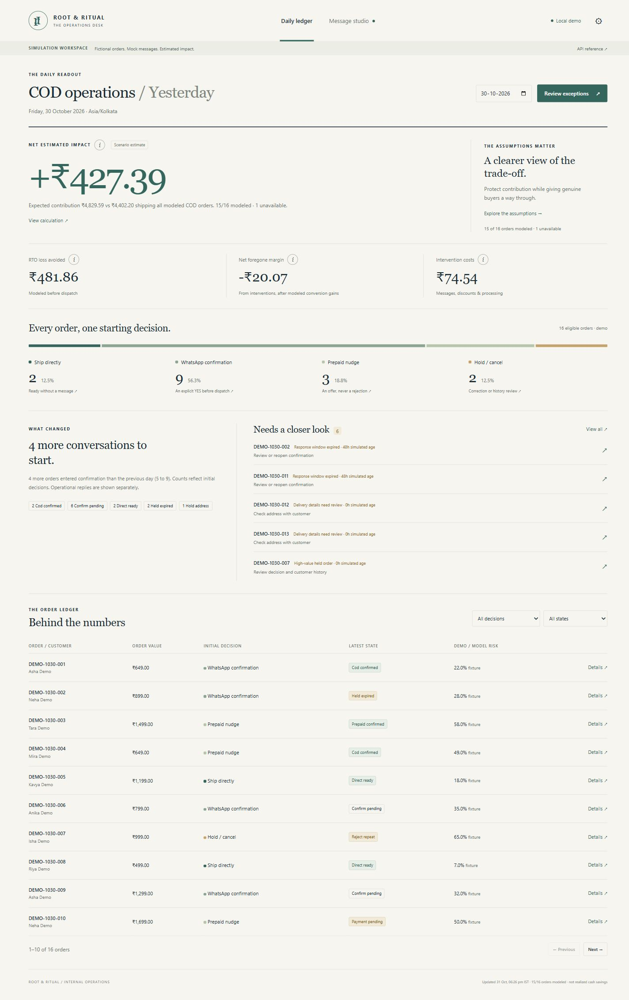
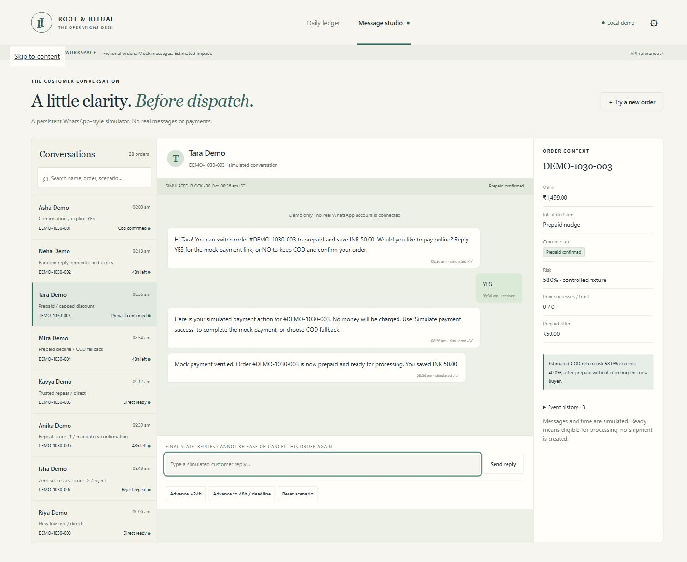

# Root & Ritual — COD Operations

A local decision engine, WhatsApp-style simulator and founder dashboard. The browser reuses the engine's ordered rules rather than duplicating policy.

## Quick start on a fresh machine

Prerequisites: **Python 3.12 installed**, internet access to download Python packages, and a terminal opened inside this project folder. No API keys, Node.js, WhatsApp account or payment gateway are required.

### Windows (PowerShell)

```powershell
py -3.12 -m venv .venv
.\.venv\Scripts\python.exe -m pip install -r requirements-lock.txt
.\.venv\Scripts\python.exe -m cod_engine.train
.\.venv\Scripts\python.exe -m pytest -q
.\.venv\Scripts\python.exe -m cod_engine.launch
```

### macOS / Linux

```bash
python3.12 -m venv .venv
.venv/bin/python -m pip install -r requirements-lock.txt
.venv/bin/python -m cod_engine.train
.venv/bin/python -m pytest -q
.venv/bin/python -m cod_engine.launch
```

Open **http://localhost:8000**. The launcher also opens a browser when the server is ready. Keep the terminal open; Ctrl+C stops it. The app has two views: **Daily ledger** and **Message studio**. API reference: http://localhost:8000/docs.

After first-time setup, the only command needed on Windows is:

```powershell
.\.venv\Scripts\python.exe -m cod_engine.launch
```

Use `--no-browser` to suppress automatic browser opening, or `--port 8002` if port 8000 is occupied. For example: `.\.venv\Scripts\python.exe -m cod_engine.launch --port 8002`.

**Fresh setup verified on 31 October 2026:** 2 minutes 51 seconds from a new Python environment through uncached dependency installation, model training, 89 passing tests and a successfully loaded dashboard. Python 3.12 was already installed. See `reports/clean-setup.md` for the timing breakdown.

The environment is local to the recipient's machine: do not copy an existing `.venv` between computers. The under-10-minute setup target assumes Python is already installed and package downloads work. Fresh-install measurements and logs are recorded in `reports/clean-setup-result.json`; actual time depends on the recipient's machine and network.

## What to share

Include `cod_engine/`, `web/`, `tests/`, `artifacts/model.joblib`, `data/orders_sample.csv`, `config.json`, both requirements files, README, reports/screenshots, examples, `DECISION_LOG.md`, `AI_USAGE_LOG.md` and the founder memo. Keep the full folder structure intact; the app finds files relative to its source folder.

Exclude `.venv/`, `.setup-check/`, caches, `.env` and `data/*.sqlite3*` from a shared copy. SQLite is generated automatically with fresh, clearly labeled fictional demo orders. You do not need to share your local conversations/settings for the app to run. `FOUNDER.MD` is the memo source; the original assignment asks for its final version as PDF or Google Doc.

## What is implemented

- **Founder ledger:** exact business date/timezone, net scenario impact, contribution baseline, component costs, coverage, four initial buckets, grounded day comparison, five prioritized exceptions, filterable/paginated orders, calculations and order drawers.
- **Message studio:** searchable conversations, customer/brand bubbles, current prompt context, simulated clock, YES/NO/random input, reminders, expiry, prepaid offer, mock payment success/failure, COD fallback, operator reopening and scenario reset.
- **Persistence:** SQLite stores initial decisions, order snapshots, workflow clocks, messages, unique event IDs, revisions/generations and settings before/after audit. Restarting the app preserves them.
- **Editable assumptions/policy:** drawer changes recalculate estimates without changing observed counts. Existing decisions, discount offers and response windows are frozen; policy edits affect future orders.
- **Accessible/responsive UI:** keyboard buttons and native dialogs with Escape/focus return, text chart summaries, click/touch info panels, horizontal table scrolling, narrow-screen context drawer, visible focus, reduced-motion styling and purposeful loading/empty/error states.
- **Engine integration:** original `POST /decide` remains available. Custom orders use the trained model; no success is fabricated when the decision service fails.

## Demo data and evidence

The app seeds **28 fictional orders**, 16 on the business day before its first run and 12 on the previous day, displayed in Asia/Kolkata. Controlled, explicitly labeled risk fixtures exercise the actual engine rules; these are not model predictions about actual customers. There are no invented observed deliveries, conversions or business savings. **Try a new order** uses the actual trained model, with no fixture risk override.

The dashboard defaults to yesterday. On a later date it may correctly show no orders; choose a previously seeded date. The independent historical CSV evaluation remains in `reports/backtest.md` and `reports/evaluation.json`. Those results are not mixed into daily demo analytics.

All live dashboard rupee totals use Decimal arithmetic and return integer paise. `value_paise`/`offer_paise` are the display money fields. The embedded original engine decision snapshot and `/decide` retain the earlier inference contract; dashboard totals never sum its binary-float monetary estimates.

## Demo walkthrough

Use yesterday's conversations, identified by their final three ID digits. Browser QA may have already advanced some examples; **Reset scenario** restores the initial request while preserving old audit events.

| Order suffix | Walkthrough |
|---|---|
| 001 | Medium-risk new buyer → Reply YES → COD confirmed; initial confirmation bucket stays unchanged. |
| 002 | Send other text → one clarification → Advance +24h → one reminder → Advance to deadline → held/expired. Late YES cannot ship. |
| 003 | New risk above 40% → capped ₹50 offer → YES → payment pending → simulate failure/retry or success → prepaid confirmed. YES alone never confirms payment. |
| 004 | Prepaid NO → new mandatory COD confirmation → YES → COD confirmed. The first NO does not cancel the order. |
| 005 / 006 / 007 | Trusted repeat ships directly without messages / score -1 confirms / score -2 with zero successes rejects under policy. |
| 009 | One success and three returns gives score -2: confirmation, never automatic rejection. |
| 010 / 011 / 012 / 013 | Seeded failed payment / expired confirmation / unusable address / ambiguous landmark address. |
| 014 | Risk exactly 40% follows confirmation economics, not a prepaid nudge. |

The simulated clock advances only via controls. It is independent per conversation and visibly labeled. A jump directly past the deadline expires immediately rather than sending a catch-up reminder after expiry. Prepaid offers also remind/expire on their offer clock; declining starts a fresh COD confirmation clock. Once a mock payment is pending, it awaits explicit success/failure/fallback; the brief supplies no payment-link expiry policy. English is the default; language is never inferred from name or location. Optional Hindi templates were not added.

READY states mean eligible for processing; no shipment is created, so there is no double-dispatch side effect. Expired conversations can be reopened only with the explicit operator control. Reset increments generation; callbacks from earlier runs are rejected. Real messaging, refunds, fulfillment and payment verification require future production adapters.

## Financial definitions

For value V, risk p, margin M=.62V and default RTO cost L=₹169.40:

```text
Ship-all contribution = (1-p)M - pL
Confirmation increment = p*a*L - (1-p)*b*M - C
Dynamic threshold = (b*M+C)/(a*L+b*M), if the denominator is positive
```

Default a=.50, b=.03 and C=₹1 are assumptions. The offer is min(5% of V, ₹50); converted-prepaid RTO q=.04 and offer acceptance 30% are assumptions. The processing fee defaults to an explicit illustrative **2%** of the discounted order value per assumed accepted transaction, including assumed RTO; fixed processing fee defaults to zero. Both are editable.

The ledger projects the policy over immutable initial decisions using stored risk. It does not treat simulated YES/payment clicks as evidence of prevented RTOs. Current operational states are shown separately. An address hold with no predicted risk is marked unavailable and excluded from financial aggregation; coverage stays visible beside the estimate. Hold/cancel scenarios assume the order remains unshipped through the horizon, so address correction recovery is not invented.

Net = avoided RTO loss − net foregone delivered margin − messages − discounts − processing. Foregone margin is signed: modeled prepaid conversion can create more delivered contribution. Discounts are incurred only on assumed delivered converted orders. A nudge costs one offer episode plus a confirmation episode on decline. Acquisition spend is sunk. Displayed components round to paise and reconcile exactly to net and policy contribution. Change a/b/acceptance/q in the assumptions drawer to explore uncertainty. These are scenario estimates, never realized cash savings.

## API contract

| Endpoint | Purpose |
|---|---|
| GET /dashboard?date=YYYY-MM-DD | Initial bucket counts, latest states, assumptions, Decimal-derived money, coverage, comparison and exceptions. |
| GET /orders?decision=&status=&day=&page=&page_size= | Filtered, paginated order ledger. |
| POST /orders | Create a custom mock order with the trained engine; CSV inference fields without final_status. Explicit timezone and at most two decimal places in order value required. Duplicate ID → 409. |
| GET /simulator/conversations?search=&state= | Search conversations/scenarios. |
| GET /simulator/{id} | Current state, prompt messages, clock, immutable decision and audit history. |
| POST /simulator/{id}/reply | `text`: YES/NO resolves from stored prompt context. Arbitrary text cannot impersonate payment callbacks. |
| POST /simulator/{id}/advance | `hours`: nonnegative simulated hours, up to 720. |
| POST /simulator/{id}/payment | `outcome`: success or failure; mock adapter only, current payment state required. |
| POST /simulator/{id}/fallback | Explicit pending-payment → COD confirmation. |
| POST /simulator/{id}/reset | Restore the original scenario; retain audit and increment generation. |
| POST /simulator/{id}/resend | Explicit operator reopen of expired order into COD confirmation. |
| GET /settings | Current policy, assumptions, revision and recent before/after audit. |
| PUT /settings | Partial `policy`/`scenario` edits plus `expected_revision`; validated and audited. |
| POST /decide; GET /config; GET /health | Original engine inference, readable active config and health. |

Every simulator mutation also requires **event_id, expected_revision and generation** from the fetched conversation. This envelope extends the brief's minimal payloads to make retries and stale callbacks safe. Example:

```json
{
  "text": "YES",
  "event_id": "operator-demo-001",
  "expected_revision": 0,
  "generation": 0
}
```

Retry the same request with the same event ID. It returns the current persisted record without another send/transition. Reusing an event ID for different content, stale revisions/generations and invalid state transitions return 409. Missing event metadata or malformed values return 422. Missing records return 404; unavailable model returns 503. The frontend passes the envelope and never blindly resubmits uncertain events.

Settings example:

```json
{
  "expected_revision": 0,
  "policy": {"confirmation_prevention": 0.75},
  "scenario": {"prepaid_acceptance": 0.60, "processing_fee_fraction": 0.02}
}
```

`config.json` supplies initial defaults. Once settings are saved through the app, the persisted policy takes precedence over file defaults. The live `/decide` reads those persisted settings too. Model smoothing/version changes still need retraining and API restart; `/config` exposes the actual training settings. Existing decisions and workflow clocks never change retroactively. `.env.example` lists COD_CONFIG, COD_MODEL and COD_DB; environment files are not auto-loaded. Use a different COD_DB path for an independent demo; no destructive reset is necessary.

## Verification and screenshots

```powershell
.\.venv\Scripts\python.exe -m pytest -q
node --check .\web\app.js
.\.venv\Scripts\python.exe -m pip check
```

**89 tests** cover the original engine plus persistent acceptance flows, payment context, reminder/expiry, retries/concurrent duplicate callbacks, stale generations, settings audit, count reconciliation, independent hand calculations, failures and restart persistence. Node is optional and used only for the development syntax check, not to run the app.

Browser walkthroughs at 1440×1000 and 390×844 verified confirmation, prepaid payment, COD fallback, settings recalculation, random messages, reminder, expiry, keyboard disclosures and narrow-screen context. An independent server with a missing model verified the explicit unavailable/retry state. `reports/operations-verification.md` records evidence and limitations.





Mobile and error screenshots are under `reports/screenshots/`.

## Implementation notes and limits

`DECISION_LOG.md` and `AI_USAGE_LOG.md` record decisions and corrections. `FOUNDER.MD` contains the founder memo source. Backend: FastAPI + SQLite + existing model. Frontend: buildless HTML/CSS/JavaScript because the repository had no React stack; one app, no duplicated policy or extra package installation.

This is a local mock, not a production deployment. The readiness states send no shipment, the payment control charges no money, and no real customer messages are sent. The service is bound to loopback; authentication, production webhook signatures, full screen-reader certification, live address verification, additional languages, payment expiry/refunds and a real outbound queue remain future work. SQLite/event history is suitable for this demonstration, not a claim of production scale. Export the founder memo source to PDF or Google Doc for the original assignment submission.
